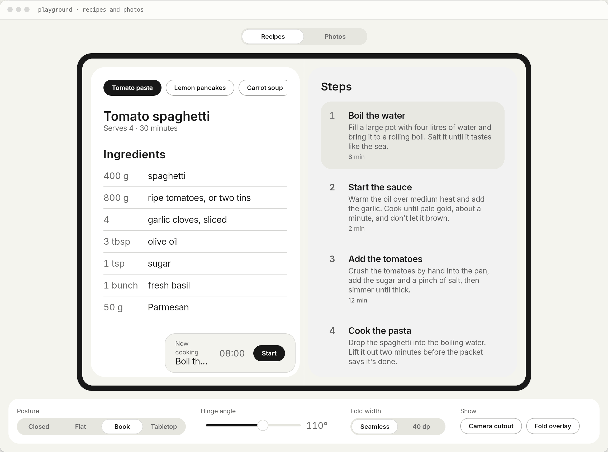
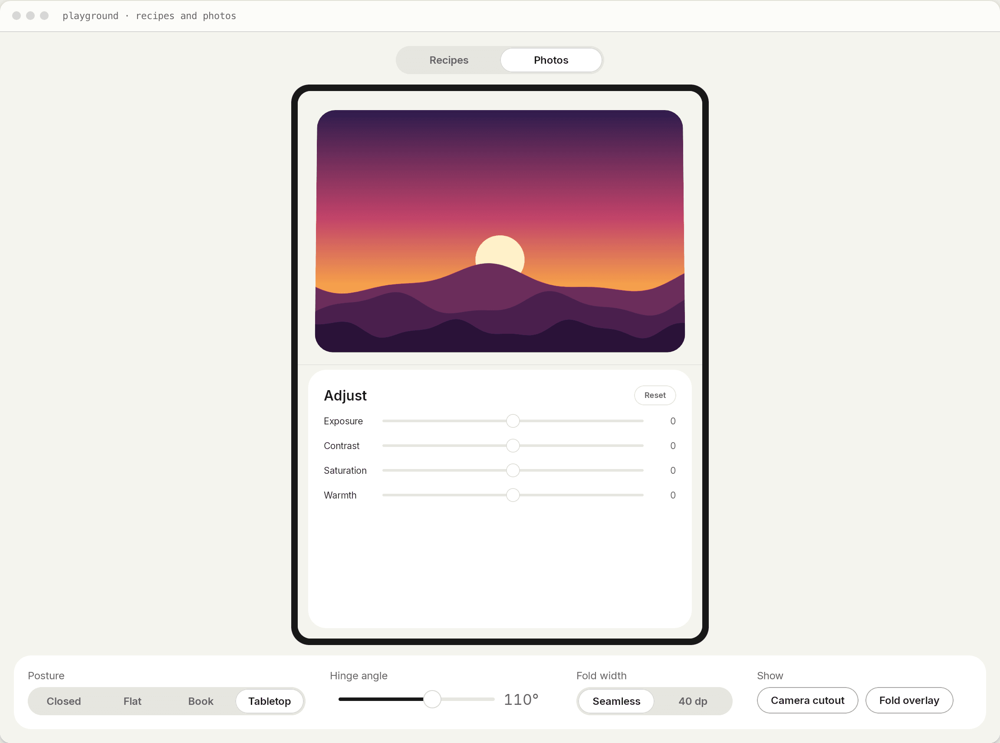
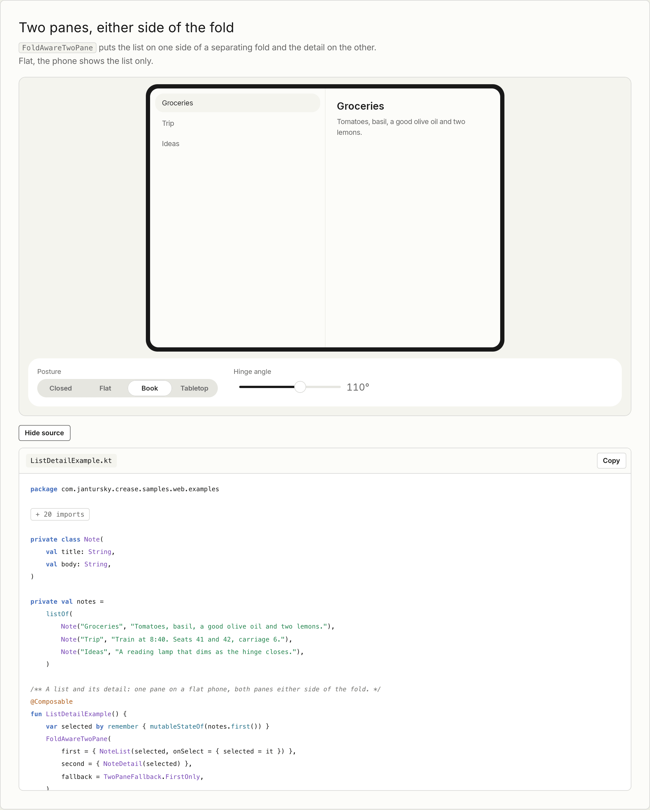

<p align="center"></p>

# Crease

[](https://central.sonatype.com/artifact/io.github.jantursky/crease) [](https://github.com/jantursky/crease/actions/workflows/ci.yml) [](https://kotlinlang.org) [](LICENSE) [](https://codecov.io/gh/jantursky/crease)

[Docs](https://crease.vercel.app) · [Demo](https://crease-demo.vercel.app) · [Maven Central](https://central.sonatype.com/artifact/io.github.jantursky/crease) · [Changelog](CHANGELOG.md)

Hinge angle, fold position and fold-aware layouts for Compose Multiplatform. One API for Android foldables and the iPhone Duo.

Android has reported folds through Jetpack WindowManager for years, and iOS 27.1 added hinge and reserved-region APIs for the iPhone Duo. Flutter and React Native picked these up quickly. Kotlin Multiplatform had nothing shared, so a Compose app had to write the same feature once per platform. Crease reads both platforms and gives your common code a single `FoldState`.

<picture>
  <source media="(prefers-color-scheme: dark)" srcset=".github/assets/recipes-dark.png">
  
</picture>

| folder              | what it is                                                                                            |
| ------------------- | ----------------------------------------------------------------------------------------------------- |
| `crease`            | The library, published to Maven Central as `io.github.jantursky:crease`.                                    |
| `crease-cover`      | Optional second artifact: show a composable on the outer display of a foldable (iOS camera capture accessory, Android rear display). |
| `samples/recipes`   | Recipe reader: ingredients and steps across the fold, a timer in tabletop mode. Android, iOS, desktop. |
| `samples/photos`    | Photo editor: picture on top and sliders below in tabletop mode, gallery and editor in book posture.   |
| `samples/web`       | The web demo and site: both samples in a simulated foldable, plus live examples with their source.     |
| `samples/design`    | Theme and widgets the samples share, plus the device simulator.                                        |
| `apps/docs`         | The docs site, built with [Blume](https://www.npmjs.com/package/blume).                                |

## Install

```kotlin
// build.gradle.kts
kotlin {
    sourceSets {
        commonMain.dependencies {
            implementation("io.github.jantursky:crease:1.0.0")
        }
    }
}
```

Targets: Android (minSdk 23), iosArm64, iosSimulatorArm64, JVM desktop and wasmJs. Desktop and browser builds report no hinge, so shared layouts fall back cleanly.

## Usage

```kotlin
import androidx.compose.foundation.layout.Column
import androidx.compose.material3.Text
import androidx.compose.runtime.Composable
import com.jantursky.crease.FoldAwareTwoPane
import com.jantursky.crease.Posture
import com.jantursky.crease.TabletopLayout
import com.jantursky.crease.TwoPaneFallback
import com.jantursky.crease.rememberFoldState
import com.jantursky.crease.rememberHinge

@Composable
fun Recipe() {
    // Book posture: one pane each side of the fold. Elsewhere: both panes side by side.
    FoldAwareTwoPane(
        first = { Text("Ingredients") },
        second = { Text("Steps") },
        fallback = TwoPaneFallback.SideBySide,
    )
}

@Composable
fun Player() {
    // Tabletop: video above the fold, controls below. Flat or closed: the video alone.
    TabletopLayout(
        top = { Text("Video") },
        bottom = { Text("Controls") },
    )
}

@Composable
fun HingeReadout() {
    val state = rememberFoldState()
    val angle = rememberHinge()?.angle
    Column {
        Text("Posture: ${state.posture}")
        if (state.posture != Posture.Flat && angle != null) Text("Hinge at ${angle.toInt()}°")
    }
}
```

`Modifier.avoidFold()` keeps a single element off the fold. `ProvideFoldState(FoldState.book(size)) { … }` feeds a fixed state to previews and UI tests. The [docs](https://crease.vercel.app) cover each of these in a guide.

Apple's guidance is to drive effects and interactions from the hinge angle, and layout from the posture and the window size. That is how the samples are built.

## Demo

The [demo](https://crease-demo.vercel.app) runs the library in the browser, compiled to Kotlin/Wasm. Both samples sit in a simulated foldable you can fold, tilt and rotate, and seven small examples run next to their own source.

<table>
  <tr>
    <td width="50%">
<picture>
  <source media="(prefers-color-scheme: dark)" srcset=".github/assets/photos-dark.png">
  
</picture>
    </td>
    <td width="50%">
<picture>
  <source media="(prefers-color-scheme: dark)" srcset=".github/assets/example-dark.png">
  
</picture>
    </td>
  </tr>
</table>

### The outer display

An optional second artifact, `io.github.jantursky:crease-cover`, shows a composable on the outer display of a foldable while your main UI stays on the inner one.

```kotlin
import androidx.compose.material3.Text
import androidx.compose.runtime.Composable
import com.jantursky.crease.cover.CoverDisplay
import com.jantursky.crease.cover.CoverDisplayState
import com.jantursky.crease.cover.rememberCoverDisplayState

@Composable
fun Camera() {
    val cover = rememberCoverDisplayState()
    CoverDisplay { Text("Smile!") }
    if (cover == CoverDisplayState.Active) Text("Showing on the outer display")
}
```

`rememberCameraDirections()` tells which cameras face the viewer on the display the UI is on (iOS 27.1 only, `null` elsewhere).

The system decides whether and where to present it, so treat it as an enhancement. On the iPhone Duo it needs an active camera capture session. The [guide](https://crease.vercel.app/guides/cover-display) has the details and what is not verified.

## How it works

1. `rememberFoldState()` returns the state from the nearest `ProvideFoldState`, or asks the platform (`crease/src/commonMain/.../RememberFoldState.kt`).
2. On Android, `WindowInfoTracker` reports `FoldingFeature`s and the `TYPE_HINGE_ANGLE` sensor (API 30+) reports the angle. Display cutouts come from the root window insets (`crease/src/androidMain/.../platform/AndroidFoldSource.kt`).
3. On iOS, a transparent view added under the Compose view hosts a `UIHingeInteraction` and reads `reservedRegionsOfKind:options:` during layout (`crease/src/nativeInterop/cinterop/CRSHingeObserverView.m`). It looks the iOS 27.1 classes up at runtime, so the library builds with older Xcode versions and turns itself off on older systems. The angle arrives in radians and is converted to degrees. The fold region lags the hinge by up to a second, so a fold is published only while the hinge reads partially open.
4. Both platforms feed plain values into the same pure mapping functions (`crease/src/commonMain/.../PlatformReadings.kt`), which build the `FoldState`: hinge status and angle, folds in window pixels, and cutouts. Posture follows from the hinge and the first fold.
5. `FoldAwareTwoPane`, `TabletopLayout` and `Modifier.avoidFold()` convert the fold from window coordinates to their own and split around it (`FoldGeometry.kt`). An occluding fold, like the 40 pt division on the iPhone Duo, is left empty.

## Prior art

- [`foldable`](https://pub.dev/packages/foldable) (Flutter): hinge angle, posture and the iPhone Duo's fold and camera regions. iOS only. Its measurements on the iPhone Duo simulator shaped the iOS side here.
- [`nitro_fold_duo`](https://pub.dev/packages/nitro_fold_duo) (Flutter): fold geometry and hinge state on both platforms, using Jetpack WindowManager on Android.
- [`iphone_duo_ui_pro`](https://pub.dev/packages/iphone_duo_ui_pro) (Flutter): ready-made iPhone Duo layouts.
- [`expo-hinge`](https://www.npmjs.com/package/expo-hinge) (Expo / React Native): hinge angle and state on Android foldables and the iPhone Duo.
- [Jetpack WindowManager](https://developer.android.com/jetpack/androidx/releases/window) and the Compose adaptive libraries: Android only.

None of them work from Kotlin Multiplatform code, which is the gap Crease fills. For the outer display, a web search found no Flutter, React Native or Kotlin Multiplatform package for iOS scene accessories and no Compose wrapper for Jetpack WindowManager's `WindowAreaController` (a search, not a look through each registry).

## Not covered yet

Crease does not wrap `UIArrangementViewController` (with `UISplitArrangement` and `UIOverlayArrangement`, UIKit's counterpart of SwiftUI's `ArrangementView`, iOS 27.1); `FoldAwareTwoPane` covers a similar need. It does not wrap `toolbarVerticalEdge` either, which I could not find in the iOS 27.1 UIKit headers or the SwiftUI interface. The outer display is covered by the optional `crease-cover` module, see below, but only as far as the iOS 27.1 SDK goes: a camera capture accessory, presented while the app has an active camera session. Android rear-display mode, which moves the whole activity and asks the user in a system dialog, is out of scope.

## Platform support

| platform | hinge status | angle | fold | cutouts |
| --- | --- | --- | --- | --- |
| Android foldables | yes | API 30+ with a hinge sensor | yes | API 28+ |
| iPhone Duo, iOS 27.1+ | yes | yes | yes | yes |
| iOS before 27.1, other iPhones | no hinge | | | |
| JVM desktop, wasmJs | no hinge | | | |

`crease-cover`, the outer display:

| platform | outer display | needs |
| --- | --- | --- |
| iPhone Duo, iOS 27.1+ | camera capture scene accessory, content can be interactive | an active camera capture session. Untested on a real device. |
| Android foldables with a rear display area | window area presentation (dual-screen mode), no consent dialog | Jetpack WindowManager's experimental window area API. Untested on a device. |
| everything else | reports `Unsupported` | |

Built with Kotlin 2.4 and Compose Multiplatform 1.12. The iOS side builds with Xcode 26 and later. Testing on the iPhone Duo simulator needs Xcode 27.1.

## Development

Needs JDK 17+, Xcode 27.1 for the iPhone Duo simulator (Xcode 26 builds the iOS side), the Android SDK, and [Bun](https://bun.sh) 1.3+ with Node 22+ for the docs, the browser tests and the screenshots.

```sh
./gradlew :crease:check :crease:koverVerify   # tests on JVM, Android (Robolectric), iOS simulator and wasm, plus coverage
./scripts/pack-test.sh                        # publish to Maven Local and compile a consumer against it
./gradlew :samples:recipes:shared:run         # desktop sample inside the device simulator
bun install && bun run dev:docs               # docs site

./gradlew :samples:web:wasmJsBrowserDistribution
bun run test:web                              # browser tests of the demo (Playwright, axe), desktop and phone
bun run screenshots                           # rebuild the demo and refresh the README screenshots
python3 design/brand/sample-icons.py          # redraw the sample app icons
```

CI runs on every push and pull request: formatting, the binary API check, the tests on every target with the coverage gate (uploaded to Codecov), the browser tests of the demo, both samples on Android and the iOS simulator, a consumer build against Maven Local and the docs build. See [CONTRIBUTING.md](CONTRIBUTING.md).

## License

[MIT](LICENSE) © Jan Tursky
