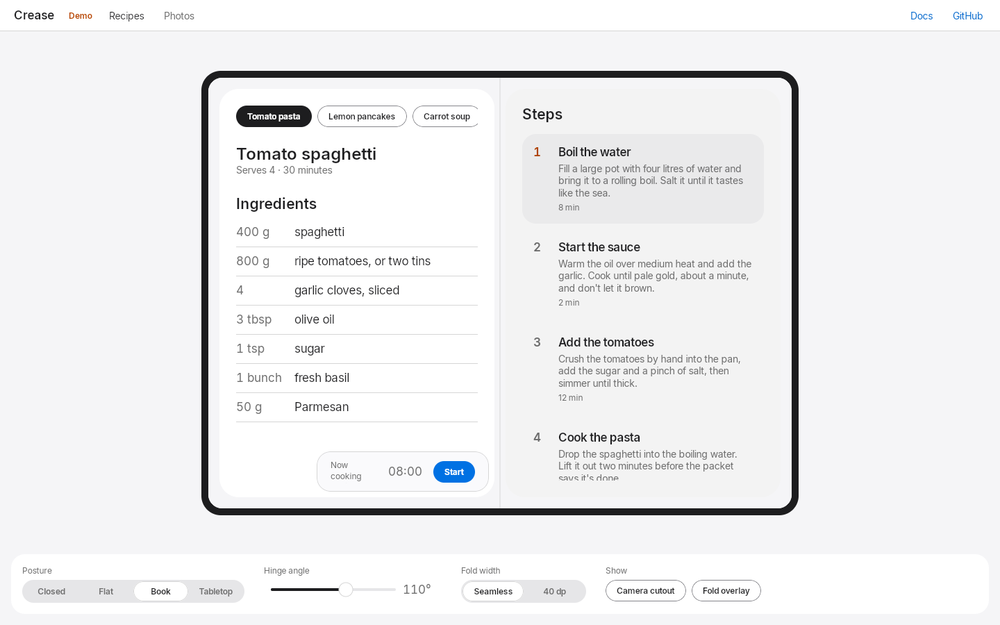

<p align="center"></p>

# Crease

[](https://central.sonatype.com/artifact/com.jantursky/crease) [](https://github.com/jantursky/crease/actions/workflows/ci.yml) [](https://kotlinlang.org) [](LICENSE) [](https://codecov.io/gh/jantursky/crease)

[Docs](https://crease.vercel.app) · [Demo](https://crease-demo.vercel.app) · [Maven Central](https://central.sonatype.com/artifact/com.jantursky/crease) · [Changelog](CHANGELOG.md)

Hinge angle, fold position and fold-aware layouts for Compose Multiplatform. One API for Android foldables and the iPhone Duo.

Android has reported folds through Jetpack WindowManager for years, and iOS 27.1 added hinge and reserved-region APIs for the iPhone Duo. Flutter and React Native picked these up quickly. Kotlin Multiplatform had nothing shared, so a Compose app had to write the same feature once per platform. Crease reads both platforms and gives your common code a single `FoldState`.



| folder              | what it is                                                                                            |
| ------------------- | ----------------------------------------------------------------------------------------------------- |
| `crease`            | The library, published to Maven Central as `com.jantursky:crease`.                                    |
| `samples/recipes`   | Recipe reader: ingredients and steps across the fold, a timer in tabletop mode. Android, iOS, desktop. |
| `samples/photos`    | Photo editor: picture on top and sliders below in tabletop mode, gallery and editor in book posture.   |
| `samples/web`       | The web demo: both samples in a simulated foldable you can fold, tilt and rotate.                      |
| `samples/design`    | Theme and widgets the samples share, plus the device simulator.                                        |
| `apps/docs`         | The docs site, built with [Blume](https://www.npmjs.com/package/blume).                                |

## Install

```kotlin
// build.gradle.kts
kotlin {
    sourceSets {
        commonMain.dependencies {
            implementation("com.jantursky:crease:1.0.0")
        }
    }
}
```

Targets: Android (minSdk 23), iosArm64, iosSimulatorArm64, JVM desktop and wasmJs. Desktop and browser builds report no hinge, so shared layouts fall back cleanly.

## Usage

```kotlin
import androidx.compose.foundation.layout.Column
import androidx.compose.material3.Text
import androidx.compose.runtime.Composable
import com.jantursky.crease.FoldAwareTwoPane
import com.jantursky.crease.Posture
import com.jantursky.crease.TabletopLayout
import com.jantursky.crease.TwoPaneFallback
import com.jantursky.crease.rememberFoldState
import com.jantursky.crease.rememberHinge

@Composable
fun Recipe() {
    // Book posture: one pane each side of the fold. Elsewhere: both panes side by side.
    FoldAwareTwoPane(
        first = { Text("Ingredients") },
        second = { Text("Steps") },
        fallback = TwoPaneFallback.SideBySide,
    )
}

@Composable
fun Player() {
    // Tabletop: video above the fold, controls below. Flat or closed: the video alone.
    TabletopLayout(
        top = { Text("Video") },
        bottom = { Text("Controls") },
    )
}

@Composable
fun HingeReadout() {
    val state = rememberFoldState()
    val angle = rememberHinge()?.angle
    Column {
        Text("Posture: ${state.posture}")
        if (state.posture != Posture.Flat && angle != null) Text("Hinge at ${angle.toInt()}°")
    }
}
```

`Modifier.avoidFold()` keeps a single element off the fold. `ProvideFoldState(FoldState.book(size)) { … }` feeds a fixed state to previews and UI tests. The [docs](https://crease.vercel.app) cover each of these in a guide.

Apple's guidance is to drive effects and interactions from the hinge angle, and layout from the posture and the window size. That is how the samples are built.

## How it works

1. `rememberFoldState()` returns the state from the nearest `ProvideFoldState`, or asks the platform (`crease/src/commonMain/.../RememberFoldState.kt`).
2. On Android, `WindowInfoTracker` reports `FoldingFeature`s and the `TYPE_HINGE_ANGLE` sensor (API 30+) reports the angle. Display cutouts come from the root window insets (`crease/src/androidMain/.../platform/AndroidFoldObserver.kt`).
3. On iOS, a transparent view added under the Compose view hosts a `UIHingeInteraction` and reads `reservedRegionsOfKind:options:` during layout (`crease/src/nativeInterop/cinterop/CRSHingeObserverView.m`). It looks the iOS 27.1 classes up at runtime, so the library builds with older Xcode versions and turns itself off on older systems. The angle arrives in radians and is converted to degrees. The fold region lags the hinge by up to a second, so a fold is published only while the hinge reads partially open.
4. Both platforms feed plain values into the same pure mapping functions (`crease/src/commonMain/.../PlatformReadings.kt`), which build the `FoldState`: hinge status and angle, folds in window pixels, and cutouts. Posture follows from the hinge and the first fold.
5. `FoldAwareTwoPane`, `TabletopLayout` and `Modifier.avoidFold()` convert the fold from window coordinates to their own and split around it (`FoldGeometry.kt`). An occluding fold, like the 40 pt division on the iPhone Duo, is left empty.

## Prior art

- [`foldable`](https://pub.dev/packages/foldable) (Flutter): hinge angle, posture and the iPhone Duo's fold and camera regions. iOS only. Its measurements on the iPhone Duo simulator shaped the iOS side here.
- [`nitro_fold_duo`](https://pub.dev/packages/nitro_fold_duo) (Flutter): fold geometry and hinge state on both platforms, using Jetpack WindowManager on Android.
- [`iphone_duo_ui_pro`](https://pub.dev/packages/iphone_duo_ui_pro) (Flutter): ready-made iPhone Duo layouts.
- [`expo-hinge`](https://www.npmjs.com/package/expo-hinge) (Expo / React Native): hinge angle and state on Android foldables and the iPhone Duo.
- [Jetpack WindowManager](https://developer.android.com/jetpack/androidx/releases/window) and the Compose adaptive libraries: Android only.

None of them work from Kotlin Multiplatform code, which is the gap Crease fills.

## Not covered yet

SwiftUI-only APIs have no UIKit counterpart that Compose can reach: `ArrangementView` (use `FoldAwareTwoPane`), `toolbarVerticalEdge` and scenes on the outer display. Android rear-display mode and `WindowAreaController` are out of scope too.

## Platform support

| platform | hinge status | angle | fold | cutouts |
| --- | --- | --- | --- | --- |
| Android foldables | yes | API 30+ with a hinge sensor | yes | API 28+ |
| iPhone Duo, iOS 27.1+ | yes | yes | yes | yes |
| iOS before 27.1, other iPhones | no hinge | | | |
| JVM desktop, wasmJs | no hinge | | | |

Built with Kotlin 2.4 and Compose Multiplatform 1.12. The iOS side builds with Xcode 26 and later. Testing on the iPhone Duo simulator needs Xcode 27.1.

## Development

```sh
./gradlew :crease:check :crease:koverVerify   # tests on JVM, Android (Robolectric), iOS simulator and wasm, plus coverage
./scripts/pack-test.sh                        # publish to Maven Local and compile a consumer against it
./gradlew :samples:recipes:shared:run         # desktop sample inside the device simulator
bun install && bun run dev:docs               # docs site
```

See [CONTRIBUTING.md](CONTRIBUTING.md).

## License

[MIT](LICENSE) © Jan Tursky
